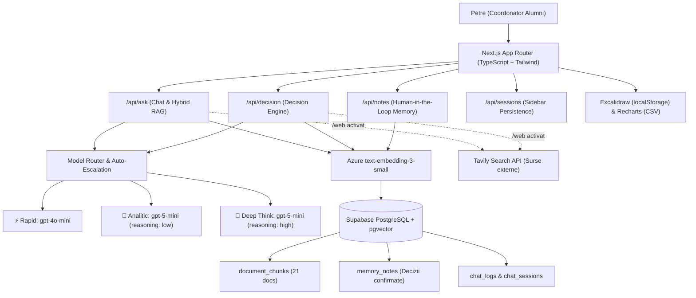

# CODE Kids Alumni · Alumn-Bot (Knowledge Management & Decision Engine)

> **Asistent instituțional RAG, motor iterativ de decizii (SWOT) și spațiu vizual de analiză**, construit pentru coordonarea **Comunității de Alumni CODE Kids** (Fundația Progress).

---

## 1. Ce face proiectul (Viziune & Rol)

**Alumn-Bot** nu este un chatbot generalist, ci un **sistem de management al cunoștințelor și suport decizional** calibrat pe procedurile interne ale organizației (21 de documente operaționale, regulamente, fișe de post, cod de conduită, sisteme de puncte/strike-uri, bugete de tabere și strategii).

Sistemul funcționează pe două direcții complementare:
1. **Memorie Instituțională (Strict Grounded RAG):** Răspunde exclusiv pe baza documentelor interne indexate și a deciziilor confirmate ulterior de coordonator, citând sursa exactă la fiecare afirmație.
2. **Consilier Critic (Devil's Advocate):** Analizează riscuri, semnalează neconcordanțe între versiuni de documente (ex. *Draft* vs. *Ghid Operațional 2027*), pune întrebări de calibrare și testează opțiuni prin sesiuni iterative de tip SWOT, **fără să ia niciodată decizii în locul omului**.

---

## 2. Arhitectura Sistemului & Stack Tehnologic

Aplicația este optimizată să ruleze cu costuri minime și control granular al cotei pe **Azure for Students ($100/an)**, combinând căutarea hibridă din PostgreSQL cu rutarea dinamică între modele LLM.



### Componente Tehnice
* **Frontend:** Next.js (App Router), React, TypeScript, Tailwind CSS.
* **Bază de date & Vector Store:** Supabase (PostgreSQL + extensia `pgvector` cu index HNSW + Full-Text Search).
* **AI & Embeddings:** Azure OpenAI (`apiVersion: 2025-04-01-preview` pentru suport nativ `reasoning_effort`):
  * `text-embedding-3-small` (1536 dimensiuni) — vectorizare documente, întrebări și notițe.
  * `gpt-4o-mini` — interogări rapide și extragere punctuală.
  * `gpt-5-mini` — raționament analitic (`low`) și audit critic / SWOT (`high`).
* **Căutare Web:** Tavily Search API (activată strict la cerere prin `/web`).
* **Vizualizări:** `@excalidraw/excalidraw` + `@excalidraw/mermaid-to-excalidraw` (diagrame editabile) și `recharts` (grafice statistice).

---

## 3. Modul de Gândire al AI-ului (Persona & Model Routing)

### A. Persona de Senior Project Manager (`ALUMNI_PM_SYSTEM_PROMPT`)
System prompt-ul impune un comportament disciplinat, orientat spre acțiune și verificare:
* **Sursa unică de adevăr:** Cunoștințele generale ale modelului sunt folosite doar pentru structurare și logică, **niciodată** ca fapte despre CODE Kids Alumni.
* **Transparență totală la calcule:** Orice calcul (retenție, ore, puncte, KPI-uri) afișează explicit formula, datele de intrare cu sursa lor și rezultatul, semnalând dacă datele din tabel sunt incomplete.
* **Proceduri și decizii despre oameni:** Pentru sancțiuni, strike-uri sau demiteri, AI-ul listează pașii numerotați, responsabilii, termenele și pragurile cu **bold**, dar **nu formulează verdicte**.

### B. Sistemul pe 3 Niveluri de Gândire (`model-router.ts`)
În RAG, mai mult „thinking” nu este întotdeauna mai bun: pe o întrebare simplă, un model cu raționament profund poate „suprainterpreta” textul și consuma inutil credite. De aceea, sistemul separă sarcinile pe 3 niveluri:

| Nivel | Model & Configurație | La ce folosește | De ce acest model |
| :--- | :--- | :--- | :--- |
| **⚡ Rapid** *(Default)* | `gpt-4o-mini` | Întrebări punctuale dintr-un singur document, praguri de puncte/strike-uri, pași exacți. | Răspunde în 1–2 secunde, cost infim (~$0.001/prompt), zero divagații pe text clar. |
| **🎯 Analitic** | `gpt-5-mini` (`reasoning_effort: low`) | Diagrame Excalidraw, grafice statistice, organigrame, corelarea a 2+ documente, neconcordanțe. | Suficient raționament cât să auditeze entitățile și să evite halucinațiile de compresie, fără latență mare. |
| **🧠 Deep Think** | `gpt-5-mini` (`reasoning_effort: high`) | Sesiuni de **Decizie** (SWOT + atacarea ipotezelor), audit de contradicții ascunse, strategii. | Construiește un arbore intern de verificare înainte de răspuns; excelent pentru gândire critică. |

*(Notă: Router-ul include și un fallback automat bazat pe blocuri `<thinking>...</thinking>` ascunse, în cazul în care se folosește un deployment fără suport nativ pentru `reasoning_effort`.)*

### C. Auto-Escaladare Inteligentă & Sigură (`⚡ → 🎯`)
Pentru a evita răspunsurile superficiale fără să consumăm bugetul pe întrebări banale, sistemul folosește o escaladare în **2 trepte**:
1. **Pre-routare deterministă (0 tokenuri extra, 0 ms latență):** Înainte de apelul LLM, backend-ul verifică dacă întrebarea cere diagrame/grafice, vizează structura/departamentele/board-ul, cere comparații/calcule sau dacă RAG-ul a adus fragmente din **≥ 2 documente diferite**. Dacă da, urcă automat pe `🎯 Analitic`.
2. **Auto-critică din mers (`[ESCALATE]`):** Dacă `⚡ Rapid` pornește totuși, dar detectează în context o contradicție între documente sau date incomplete, are instrucțiunea să returneze doar tag-ul `[ESCALATE]`. Backend-ul îl interceptează și retrimite cererea către `🎯 Analitic` într-un singur salt.
* **Protecție FinOps:** Auto-escaladarea are plafon maxim la `Analitic` (nu sare niciodată singură la `Deep Think`) și poate fi oprită din UI printr-un checkbox dedicat.

---

## 4. Funcționalități Detaliate (Ce / Cum / De ce)

### 1. Hybrid RAG Pipeline (`/api/ask`)
* **Ce face:** Caută simultan semantic (înțeles) și lexical (cuvinte cheie exacte, coduri de articole, nume de documente) în cele 21 de documente indexate, cu filtrare opțională pe departament (*Tehnic, Comunicare, Comunități, Coordonare Județeană*).
* **Cum face:** Generează embedding-ul întrebării cu `text-embedding-3-small` și apelează funcția RPC `match_documents` din Supabase (combinând distanța cosinus `pgvector` cu PostgreSQL `ts_rank`), filtrând fragmentele sub pragul de similaritate `0.35`.
* **De ce:** Căutarea pur vectorială poate rata termeni specifici (ex. *„Nivelul 3”*, *„Ghid 2027”*), iar căutarea pur pe cuvinte cheie ratează sinonimele. Hibridul le acoperă pe ambele.

### 2. Memorie Episodică Controlată — `Notes` (`/api/notes`)
* **Ce face:** Permite sistemului să „învețe” decizii operaționale noi, excepții temporare sau rezolvări ale conflictelor dintre documente, fără a modifica vreodată documentele sursă.
* **Cum face:** Când Petre formulează o decizie clară în chat (nu o simplă ipoteză), AI-ul atașează la final tag-ul invizibil `[NOTE_PROPOSAL: ...]`. Interfața afișează un card de confirmare cu butonul **`Da, adaugă în Notes`**. Abia la click se vectorizează notița și se salvează în tabela `memory_notes`. La întrebările viitoare, `match_memory_notes` aduce top 3 notițe relevante cu prioritate peste draft-uri.
* **De ce:** Previne **Context Poisoning** (salvarea unor idei de brainstorming ca reguli oficiale) și costă **0 apeluri LLM extra** pentru detecție.

### 3. Motorul Iterativ de Decizii — `Decision Engine` (`/api/decision`)
* **Ce face:** Ghidează luarea deciziilor strategice printr-un proces structurat pe `N` iterații (configurabil `1–5`), în care AI-ul atacă ideile, face stress-test SWOT și cere calibrare pas cu pas.
* **Cum face:**
  * **Research Caching:** Căutarea în documente (și opțional online via `/web`) se face **o singură dată** la început și este păstrată în starea sesiunii (`researchCache`), economisind tokenuri la iterațiile următoare. Dacă nu găsește nimic în KB și `/web` e oprit, cere permisiunea explicită înainte de a căuta pe internet.
  * **Pasul 0 (Aliniere & Atacarea Premisei):** Înainte de a propune soluții, AI-ul pune 3–4 întrebări critice (*de ce* rezolvăm asta, *cum* stăm cu retenția și constrângerile).
  * **Iterațiile `1 .. N-1` (Propuneri + Mini-SWOT):** Generează opțiuni distincte, le atacă pe fiecare (*De ce merge* vs. *De ce crapă*) și oferă un box de feedback activ by default.
  * **Iterația `N` (Propunere Finală):** Sintetizează soluția recomandată, măsurile de blocare a riscurilor și impactul pe procedurile existente, cu buton de salvare directă în `Notes`.
* **De ce:** Înlocuiește răspunsurile plate de tip „lista de idei” cu un proces real de validare, forțând atacarea punctelor slabe înainte de implementare.

### 4. Căutare Web Opt-In (`/web` via Tavily)
* **Ce face:** Aduce informații externe (legislație, GDPR, voluntariat, finanțatori, bune practici) strict când utilizatorul activează `/web`.
* **Cum face:** Fără `/web`, AI-ul are interdicție absolută să acceseze internetul, dar propune proactiv o căutare la finalul răspunsului când detectează informații externe sau depășite (oferind un buton de 1-click pentru execuție). Rezultatele web sunt injectate într-o secțiune separată de documentele interne.
* **De ce:** Elimină contaminarea regulilor interne cu informații generice de pe internet și păstrează controlul asupra apelurilor externe.

### 5. Vizualizări Interactive: Excalidraw & Recharts
* **Excalidraw (`ExcalidrawDiagram.tsx`):**
  * **Ce face:** Transformă procedurile, fluxurile decizionale și organigramele într-o tablă albă interactivă, editabilă direct în chat.
  * **Cum face:** AI-ul generează sintaxă ` ```mermaid `, iar componenta o convertește automat în elemente Excalidraw (`parseMermaidToExcalidraw`). Modificările manuale făcute de utilizator (mutare noduri, săgeți noi, text) se salvează automat în `localStorage` (fără a încărca baza de date), cu butoane pentru **Fullscreen**, **Export PNG**, **Export SVG** și **Resetare**.
* **Grafice Statistice (`StatsChart.tsx`):**
  * **Ce face:** Randează grafice interactive (`Bar`, `Line`, `Pie`) pentru bugete, retenție sau distribuții pe departamente.
  * **Cum face:** AI-ul emite un bloc ` ```chart ` în format JSON validat, randat prin `recharts` cu schimbare instantanee între tipurile de grafic și export **CSV**.

### 6. Istoric Persistent & Sidebar (`/api/sessions`)
* **Ce face:** Salvează automat atât conversațiile standard, cât și starea completă a sesiunilor de decizie (`decision_state`), permițând reluarea lor oricând.
* **Cum face:** Tabelele `chat_sessions` și `chat_messages` din Supabase stochează mesajele, sursele citate, metadatele de cost și progresul iterațiilor. Sidebar-ul oferă creare chat nou (`+ Chat nou`), redenumire inline (`✏️`) și ștergere (`✕`).

### 7. Telemetrie FinOps (Tokenuri & Costuri)
* **Ce face:** Monitorizează consumul în timp real la 3 niveluri: **per prompt**, **per sesiune curentă** și **all-time** (cumulat din `chat_logs`).
* **Cum face:** Calculează costul estimat în USD pe baza tarifelor specifice fiecărui model (`embedding`, `prompt_tokens`, `completion_tokens`), oferind vizibilitate completă asupra consumului din bugetul Azure for Students.

---

## 5. Precauții, Guardrails și Anti-Halucinație

Deoarece sistemul lucrează cu regulamente interne, date despre minori și decizii organizaționale, au fost implementate **5 straturi de protecție**:

1. **Verbatim Label Lock (Interdicție de compresie/redenumire):**
   * *Problema prevenită:* Modelele mici tind să „rezume” roluri sau departamente în etichete inventate când desenează diagrame (ex. inventarea unui *„Departament de Creare”* în loc de *Comunicare* sau *Makers/Shapers/Explorers*).
   * *Soluția:* Regulă explicită în prompt care interzice orice parafrazare sau traducere a entităților organizaționale — AI-ul folosește exclusiv denumirile literale din documente.
2. **Anti-Hallucination Verification Gate:**
   * *Soluția:* În modurile `Analitic` și `Deep Think`, modelul este obligat să execute un audit literal al fiecărui nume, prag numeric și nod de diagramă față de `CONTEXT DOCUMENTE` înainte de a genera răspunsul. Orice element absent este marcat explicit `[Lipsă în documente]`.
3. **Protocolul de Conflicte între Surse:**
   * *Soluția:* Când două documente se contrazic (ex. *Baza de date 2025* vs. *2026* sau *Draft* vs. *Final*), AI-ul are interdicție să aleagă singur varianta corectă. Prezintă ambele variante cu sursele lor și cere decizia lui Petre (pe care o poate salva apoi în `Notes`).
4. **Human-in-the-Loop Strict (Zero Autoritate Executivă):**
   * *Soluția:* AI-ul nu modifică niciodată documentele din baza de cunoștințe (sunt *read-only*), nu salvează nimic în memorie fără confirmare prin click și nu emite verdicte asupra membrilor.
5. **Protecția Datelor Sensibile:**
   * *Soluția:* Cheile API și secretele rămân strict pe server (Next.js Route Handlers), iar system prompt-ul blochează afișarea parolelor sau a datelor de acces chiar dacă acestea apar accidental în vreun document indexat.

---

## 6. Structura Proiectului

```text
├── app/
│   ├── api/
│   │   ├── ask/route.ts             # Motor Hybrid RAG + Auto-Escaladare + /web
│   │   ├── decision/route.ts        # Motor iterativ de decizii (Pas 0 + SWOT 1..N)
│   │   ├── notes/route.ts           # Salvare & vectorizare decizii confirmate
│   │   └── sessions/
│   │       ├── route.ts             # Listare & creare sesiuni chat/decizie
│   │       └── [id]/route.ts        # Încărcare, redenumire, update & ștergere sesiune
│   ├── components/
│   │   ├── ExcalidrawDiagram.tsx    # Conversie Mermaid -> Excalidraw + localStorage + Export
│   │   └── StatsChart.tsx           # Grafice interactive Recharts (Bar/Line/Pie) + CSV
│   ├── lib/
│   │   ├── model-router.ts          # Logica Rapid / Analitic / Deep Think + Verification Gate
│   │   └── system-prompt.ts         # Persona PM, reguli RAG, anti-halucinație & formatare
│   └── page.tsx                     # Interfața principală (Sidebar, Chat, Decision UI, FinOps)
├── clean_docs/                      # Cele 21 de documente Markdown procesate
└── scripts/                         # Scripturi de ingestie și chunking semantic în Supabase
```

---

## 7. Configurare & Variabile de Mediu (`.env.local`)

Pentru a rula proiectul local, configurează următoarele variabile în `.env.local`:

```env
# Azure OpenAI (Endpoint & Key din Azure AI Foundry)
AZURE_OPENAI_ENDPOINT=https://<resursa-ta>.openai.azure.com/
AZURE_OPENAI_API_KEY=<cheia-ta-azure>

# Deployments Azure OpenAI
AZURE_EMBEDDING_DEPLOYMENT=text-embedding-3-small
AZURE_CHAT_DEPLOYMENT=gpt-4o-mini
AZURE_ANALYTIC_DEPLOYMENT=gpt-5-mini
AZURE_DEEP_DEPLOYMENT=gpt-5-mini

# Supabase (Database + pgvector)
NEXT_PUBLIC_SUPABASE_URL=https://<proiectul-tau>.supabase.co
NEXT_PUBLIC_SUPABASE_PUBLISHABLE_KEY=<anon-key>
SUPABASE_SECRET_KEY=<service-role-secret-key>

# Tavily Search API (pentru comanda /web)
TAVILY_API_KEY=<cheia-ta-tavily>
```

### Pornire locală
```bash
npm install --legacy-peer-deps
npm run dev
```