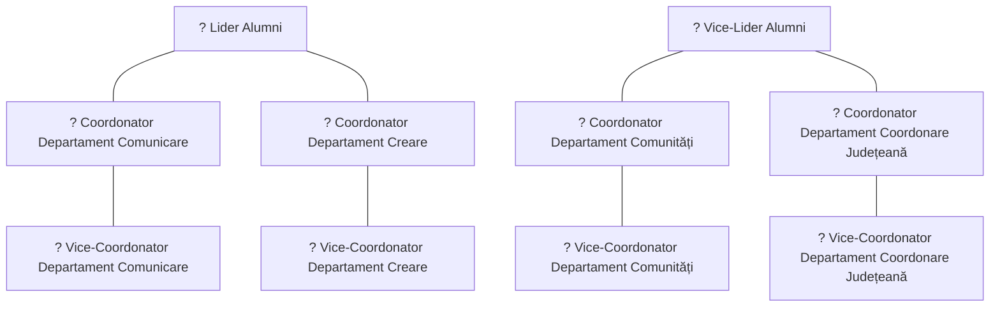

logo: Progress Foundation
logo: Code Kids

## **Procedură Alegere Board al Alumnilor 2026**

Alegerea noului board de conducere al Alumnilor Fundației Progress 2026 reprezintă un moment important în activitatea anuală desfășurată de către alumni. A fi în board este o responsabilitate foarte mare în momentul actual, astfel procedura de alegere a boardului devine din ce în ce mai complexă din dorința ca alegerea să fie una cât mai bună, să avem o structură de aleși a boardului cât mai solidă pe care să ne bazăm, atât voi (alumnii), cât și noi (Fundația Progress).

**Structura alegerilor pentru BOARD ALUMNI 2026 include următoarele poziții:**

Structura este axată pe cele 4 departamente ale Alumnilor (Tehnic, Comunicare, Coordonare Județeană și Comunități) fiind prevăzuți câte un coordonator responsabil de departament și un vice-coordonator care să ofere sprijin în implementarea activităților și monitorizarea alumnilor din departament.

Structura este completată de un Lider și un Vice-Lider care colaborează în mod direct cu boardul Alumnilor și mențin legătura cu Coordonatorul Alumnilor și Managerul CODE Kids.

Începând din acest an, la nivelul conducerii Alumnilor va fi introdus și conceptul de current lider și past lider, cu rolul de a asigura continuitatea și transferul de know-how între mandate. În situația în care aceeași persoană este realasă în funcția de Lider al Alumnilor, rolul de past lider nu se activează, atribuțiile fiind exercitate exclusiv în calitate de current lider.

Calendarul alegerilor a fost devansat cu o lună, astfel încât luna februarie să fie folosită pentru transferul de cunoștințe și experiență de la foștii membri de board către cei noi. În acest fel, la începutul mandatului din martie, membrii board-ului vor fi pregătiți să își preia responsabilitățile în mod eficient.

icon: website www.codekids.ro | icon: email codekids@progressfoundation.ro | icon: facebook @CodeKidsRomania | icon: instagram /fundatia_progress | icon: tiktok @codekidsro

logo: Progress Foundation
logo: Code Kids

## **Principii generale referitoare la alegerea postului pentru care poți aplica:**

- Aplicantul poate aplica doar pentru una dintre cele 2 poziții de conducere (Lider sau Vice-Lider) și doar pentru una dintre cele 8 poziții de coordonare departament.
- În cazul în care aplicantul dorește să aplice și pentru poziție de conducere și pentru poziție de coordonare atunci acesta va fi nevoit să participe la ambele proceduri de selecție și să realizeze toate materialele necesare ambelor proceduri.
- În cazul în care nu sunt suficienți aplicanti pentru o poziție sau coordonatorul alumnilor împreuna cu managerul de proiect considera ca aplicantul este mai potrivit pentru alta pozitie, atunci aplicantului i se va propune o variantă alternativă, rămânând la decizia acestuia dacă o acceptă sau refuză, fără alte repercusiuni.
- Aplicantul trebuie să fie asumat, să selecteze cu atenție poziția cea mai potrivită pentru acesta și pentru care concurează;
- Aplicantul trebuie să fie conștient de posibilitatea ca acesta să nu fie cel ales și să nu lase impactul imediat să îi influențeze activitatea în grupul de Alumni.

## **Etapele de selecție a Liderului și Vice-Liderului:**

1. Completarea formularului de înscriere: **23 decembrie 2025 - 9 ianuarie 2026**
2. Realizarea unei prezentări informative pentru întâlnirea online de alegere
3. Feedback pe prezentări oferit de către Coordonatorul CODE Kids și implementarea feedback-ului în cadrul prezentărilor
4. Pregătirea prezentărilor
5. Întâlnirea online de alegere a Liderului și Vice-Liderului

## **Structură recomandată pentru prezentarea utilizată și opțională a Liderului/Vice-Liderului:**

- Prezentare sumară (scurtă) a aplicantului (vârsta, educație-pregatire de specialitate, experienta acumulata in domeniu, pasiuni, membru în echipe etc.);

icon: website www.codekids.ro | icon: email codekids@progressfoundation.ro | icon: facebook @CodeKidsRomania | icon: instagram /fundatia_progress | icon: tiktok @codekidsro

logo: Progress Foundation
logo: Code Kids

- Planul aplicantului pentru grupul de alumni pentru anul 2026 (etapele și activități planificate pe luni ale anului - tip Gantt, acțiuni propuse), obiective / ținta 2026, orice altceva este necesar de cuprins pentru detalierea planului - pentru grupul de alumni în general.
- Ce îl recomandă pe aplicant pentru poziția respectivă (calitati, defecte - provocari personale, realizari pana in prezent cu accent pe CODE Kids);

\*Structura prezentării poate fi agreată, la solicitarea aplicantului, de către Coordonatorul Alumnilor
- este recomandat o scurtă detaliere a principalelor idei pentru validarea acestora. De asemenea, este încurajată utilizarea template-ului propus pentru această procedură.

## **Întâlnirea de alegere a Liderului/Vice-Liderului Alumnilor 2026**

- **Categoria: Vice-Lider** - fiecare vice-lider, într-o ordine aleatoare, va avea la dispoziție maxim 5 minute de prezentare a informațiilor referitor la planul pe care aplicantul îl va avea pe parcursul anului pentru poziția respectivă;
- După fiecare prezentare urmează o serie de întrebări (maxim 2) din partea alumnilor votanți și maxim 2 întrebări din partea angajaților Fundației Progress;
- **Categoria: Lider - fiecare lider**, într-o ordine aleatoare, va avea la dispoziție maxim 5 minute de prezentare a informațiilor referitor la planul pe care aplicantul îl va avea pe parcursul anului pentru poziția respectivă;
- După fiecare prezentare urmează o serie de întrebări (maxim 2) din partea alumnilor votanți și maxim 2 întrebări din partea angajaților Fundației Progress;
- **Voting anonim** - toți participanții vor primi un formular de votare în care vor avea dreptul să voteze un singur lider și un singur vice-lider. Ulterior, echipa CODE Kids va realiza calculul punctajelor.
- **Anunțarea Liderului și a Vice-Liderului** - Coordonatorul CODE Kids va anunța câștigătorii și va publica toată grila de punctare, pe toate componentele respective.
- !!! Ulterior, în cadrul întâlnirii, în cazul în care liderul și vice-liderul ales nu realizează un context problematic asupra structurii coordonatorilor și vice-coordonatorilor (ex: coordonatorul ales pentru un departament câștigă rolul de lider/vice-lider), coordonatorul Alumnilor va anunța coordonatorii și vice-coordonatorii aleși. În caz contrat, în termen de 3 zile se vor anunța coordonatorii și vice-coordonatorii.

icon: website www.codekids.ro | icon: email codekids@progressfoundation.ro | icon: facebook @CodeKidsRomania | icon: instagram /fundatia_progress | icon: tiktok @codekidsro

logo: Progress Foundation
logo: Code Kids

## **Punctajul și acordarea punctelor:**

În etapele de selecție, punctele sunt acordate astfel:

- 20 puncte - formularul de aplicare (complexitatea răspunsurilor, argumentarea lor și ilustrarea cu exemple din practică și din experiența anterioară a aplicantului);
- 20 puncte - nivelul de activitate și implicare pe parcursul anului 2025 în proiectele Fundației Progress;
- 60 puncte în cadrul întâlnirii de selectare a Liderului și Vice-Liderului:
  - Maxim 30 puncte în urma voturilor alumnilor (reprezentând, proporțional numărul de voturi obținute din 100% exprimate de alumnii)\*;
  - Maxim 30 puncte în urma voturilor angajaților Fundației Progress;
    \*spre exemplu: din 100 de voturi ale alumnilor, Ion a primit 60 de voturi, astfel ion primește 18 puncte din 30 puncte).

## **Diferențele dintre Lider și Vice-Lider în funcție de profilul alumnului:**

### **- Liderul:**

- Este un bun strateg, poate urmări evoluția întregului grup și să vină cu propuneri general valabile și aplicabile;
- Este rațional, ordonat și îi place să lucreze cu statistici și să interpreteze tabelele de urmărire a activității pentru a trage concluzii;
- Este un bun vorbitor în public, își folosește emoțiile pozitiv și poate participa la interviuri/înregistrări pe care să le utilizăm în Social Media;
- Este mai axat pe integrarea proiectelor Fundației Progress în cadrul grupului de Alumni;
- Se va consulta cu Coordonatorul Alumnilor și Managerul CODE Kids referitor la cheltuieli necesare grupului de Alumni;
- Este focusat pe dezvoltarea alumnilor ca organizare, eficientizare a lucrului în echipă și comunicării.

### **- Vice-Liderul:**

- Este un bun ascultător, va colecta feedback de la alumni în vederea îmbunătățirii experienței lor;

icon: web www.codekids.ro | icon: email codekids@progressfoundation.ro | icon: facebook @CodeKidsRomania | icon: instagram /fundatia_progress | icon: tiktok @codekidsro

logo: Progress Foundation
logo: Code Kids

- Este focusat pe individ, va comunica constant cu alumnii atât în privat, cât și pe grupuri;
- Va încerca să identifice toate problemele care sunt între alumni sau care țin de alumni și se va consulta cu cei din board pentru găsirea unei soluții cât mai bune;
- Este focusat pe realizarea de activități de entertainment (schimb de scrisori, întâlniri de socializare, seri de joacă) pentru creșterea bunăstării alumnilor;
- Este axat pe dezvoltarea alumnilor privind apartenența la echipă, unitate, suport și sprijin reciproc.

## **Etapile de selecție a Coordonatorilor/Vice-coordonatorilor de Departamente:**

1. Completarea formularului de înscriere: **23 decembrie 2025 - 9 ianuarie 2026**
2. Completarea strategiei pentru anul 2026 pentru departamentul selectat
**3.** Feedback pe completarea strategiei oferit de către Coordonatorul CODE Kids și implementarea feedback
4. Ședință internă de analiza a planurilor. Persoanele care vor participa la întâlnire:
   - Camelia Crișan, CEO Fundația Progress
   - Oana Trifan, Comunicare Fundația Progress
   - Carlos Catana & Emi Furnigea, Departament Tehnic Fundația Progress
   - Ervin Bolat, Manager CODE Kids
   - Ana-Maria Melinte, Coordonator Alumni
   - Maria David, Asistent Program Fundația Progress
5. Anunțarea rezultatelor - Întâlnirea online cu board-ul pentru a alege coordonatorii si vice-coordonatorii **la maxim 3 zile lucrătoare în eventualitatea unei indecizii temporare.**

## **Punctajul și acordarea punctelor:**

În etapele de selecție, punctele sunt acordate astfel:

- 20 puncte - formularul de aplicare (gradul de complexitate și evidențierea competențelor specifice departamentului pentru care candidează în calitate de viitor coordonator/vice-coordonator);
- 35 puncte - nivelul de activitate și implicare pe parcursul anului 2025;
- 15 puncte - feedback din partea boardului 2025;

icon: website www.codekids.ro | icon: email codekids@progressfoundation.ro | icon: facebook @CodeKidsRomania | icon: instagram /fundatia_progress | icon: tiktok @codekidsro

logo: Progress Foundation
logo: Code Kids

- 30 puncte - analiza strategiilor pentru anul 2025 privind activitatea departamentului;

\*Un template va fi propus aplicaților pentru a se asigura că urmăresc principalele aspecte punctate de către echipa Progress.

**Structura planului de strategie se va baza pe obiectivul departamentului pentru care aplici.**

**Obiectiv Departament Tehnic:** Sprijinirea educațională a beneficiarilor programului CODE Kids pe parcursul anului 2026. Sunt așteptate următoarele rezultate: tutoriale tip pdf calitative și complete, tutoriale video calitative pentru Youtube, instruiri tehnice etc..

**Obiectiv Departament Comunicare:** Creșterea brandului echipei de Alumni CODE Kids și asigurarea unui sprijin constant pentru echipa de comunicare a Fundației Progress. Sunt așteptate următoarele rezultate: followers pe instagram, share-uri organice pentru fiecare rundă de share, promovarea evenimentele grupului de Alumni și orice alte rezultate așteptate prevăzute ulterior de echipa de comunicare a Fundației Progress.

**Obiectiv Departament Coordonare Județeană:** Sprijinirea coordonatorilor de cluburi CODE Kids prin suport tehnic, informatic, diseminarea informației și extragerea de feedback de la coordonatori și coderi. Sunt așteptare următoarele rezultate: coordonarea echipei de Alumni Juniori, realizarea necesarului de apeluri, coordonarea ambasadorilor etc..

**Obiectiv Departament Comunități:** Monitorizarea, sprijinirea și încheierea comunităților CODE Kids prin activități de socializare, entertainment și educaționale. Comunități: grupul ambasadorilor, grupurile alumnilor, canalul de discord, grupul de alumni juniori, coderii începători, coderii avansați etc..

**De cuprins în strategie:**

icon: website www.codekids.ro | icon: email codekids@progressfoundation.ro | icon: facebook @CodeKidsRomania | icon: instagram /fundatia_progress | icon: TikTok @codekidsro

logo: Progress Foundation
logo: Code Kids

- Planul de activități ale departamentului - ce activități îți propui să faceți (tu și alumnii din departament) pe parcursul anului?
- Mod de organizare:
  - informații detaliate despre cum vor fi organizați alumnii din departament
  - recurența ședințelor și cum vor fi structurate ședințele
  - cum vor fi distribuite activitățile și frecvența activităților
  - Informatii despre cum o sa descurca colaborarea intre departamente
  - orice informație adițională
- Activități de socializare, de motivare a grupului de alumni (departament)
- Riscurile și problemele actuale și soluții pentru ele
- Orice îți dorești să treci în această strategie și nu este cuprind în structura de mai sus de subiecte

icon: website www.codekids.ro | icon: email codekids@progressfoundation.ro | icon: Facebook @CodeKidsRomania | icon: Instagram /fundatia_progress | icon: TikTok @codekidsro

logo: Progress Foundation
logo: Code Kids

- **Nr**:
- **Data**:

## **FIȘA POSTULUI**

**Denumirea postului:** **Coordonator / Vice-Coordonator Departament Alumni CODE Kids**

- **Nume, prenume**:

### **DESCRIEREA POSTULUI:**

**Scopul:** Coordonatorul de Departament Alumni CODE Kids este un lider al unui departament specific care coordonează și observă toate activitățile membrilor departamentului mergând pe un plan de activități integrate în timp conform programei de activități și strategiei CODE Kids.

----

- **Atribuții**:

----

| Titlu activitate | Sarcini |
| --- | --- |
| Asigură integritatea și unitatea departamentului | - Oferă viziunea de dezvoltare a rețelei de alumni, conduce și ia decizii cu consultarea tuturor părților interesate; - Menține implicarea constantă a membrilor prin motivare, activități de dezvoltare personală sau profesională; - Lucrează constant la formarea unui departament cât mai unit; |
| Realizează atribuțiile membrului Alumn CODE Kids | - Organizează și susține prezentări pe zona tehnică copiilor și coordonatorilor cluburilor CODE Kids (Dep. Tehnic); - Crearea de materiale didactice tehnice și nu numai adaptate la nevoile educaționale ale programului CODE Kids (Dep. Tehnic); - Coordonează și menține o bună desfășurare a discuțiilor pe serverul de Discord (Dep. Comunități); - Organizarea și implementarea de activități și evenimente extracurriculare destinate beneficiarilor CODE Kids (Dep. Comunități); - Realizează promovare organică online prin Share (Dep. Comunicare); - Efectuează activități online de promovare și management al rețelor de socializare (Dep. Comunicare); - Sprijină online implementarea programului CODE Kids prin eficientizarea colaborării cu coordonatorii cluburilor (Dep. Coordonare Județeană). - Coordonează structura Alumnilor Juniori (Dep. Coordonare Județeană). - Anunță Coordonatorul Alumnilor de fiecare dată când apar probleme sau este necesar a fi luată o decizie; - Participă la ședințele generale; - Participă la Evenimentele și cursurile destinate participanților CODE Kids; |
| Coordonează activitățile generale și specifice ale propriului departament | - Se consultă constant cu Coordonatorul Alumnilor, Liderul Alumn și Vice-Liderul Alumn referitor la activitățile care trebuie realizate; - Realizează o strategie pe termen mediu-lung de activități; - Se asigură că toate activitățile se desfășoară în condiții optime și la timp; |

----

| icon: website www.codekids.ro | | icon: email codekids@progressfoundation.ro | | | icon: facebook @CodeKidsRomania | | | icon: instagram /fundatia_progress | | | icon: tiktok @codekidsro

logo: Progress Foundation

logo: Code Kids

- **Nr**:
- **Data**:

| Asigură sustenabilitatea proiectului CODE Kids | - Menține legătura strânsă cu cluburile din județul/județele pe care le are sub supraveghere; - Monitorizează activitatea cluburilor pe care le are sub supraveghere; - Anunță Reprezentantul Progress în toate cazurile esențiale - Asigură un flow constant de activități adaptate la necesitățile programului CODE Kids din momentul respectiv; - Să asigure handover pentru noua structură a boardului ales; - Implementează acțiuni specifice delegate de către managerul programului CODE Kids; |
| --- | --- |
| Participă la activitățile Boardului de Alumni | - Participă la ședințele Boardului de Alumni; - Menține o legătură strânsă cu ceilalți membri ai Boardului de Alumni; - Stabilește împreună cu Boardul de Alumni următoarele întâlniri și activități de grup; |

**Cerințe:**
- Absolvent al proiectului CODE Kids (**2 ani de activități în cadrul proiectului (22luni)**);
- Minim un an de activitate în calitate de Alumn;
- Cunoștințe tehnice cuprinse în curricula CODE Kids;
- Bune abilități de comunicare;
- Abilități de coordonare a oamenilor;
- Activitate mediu-ridicată (**minim 70% din activități realizate cu succes**) pe parcursul anului 2025;
- Minim **14 ani împliniți** pentru funcția de Coordonator și minim **13 ani împliniți** pentru funcția de Vice-Coordonator la momentul începerii noului an CODE Kids - **3 martie 2026**);
- Să nu fi ocupat aceeași funcție pentru care aplică mai mult de 2 ani de zile în momentul alegerii noului board. (**Atenție!** Cei 2 ani de zile reprezintă 2 mandate complete pe o anumită funcție, adică echivalentul a 24 luni calendaristice.)
- Să poată oferi un număr între **6-8 ore pe săptămână** pentru realizarea activităților de management prevăzute în fișa postului;

\*Pentru alumnii externi (care nu au beneficiat de programul CODE Kids, din cauză nu au absolvit programul) este necesară validarea competențelor prevăzute în curricula CODE Kids printr-un interviu cu managerul programului CODE Kids și a altor 3 membri din echipa CODE Kids.

- **RELAȚII DE MUNCĂ**:
  - **Se subordonează direct**: Managerului, Coordonatorului Alumnilor, Lider Alumn și Vice-Lider Alumn
  - **Este în relații directe cu**: Toți colegii grupului de Alumni
  - **Are în subordonare directă**: Membrii departamentului pe care îl coordonează
- **CONDIȚII DE MUNCĂ**:
  - **Perioada**: Februarie 2026 - Februarie 2027
  - **Programul de lucru**:
  - **Locul de desfășurare a activității**:
    - **Online**: 90
    - **Offline**: 10
    - **La sediul**: 0
    - **(acasă)**:
    - **partenerilor**:

icon: website www.codekids.ro | icon: email codekids@progressfoundation.ro | icon: facebook @CodeKidsRomania | icon: instagram /fundatia_progress | icon: TikTok @codekidsro

logo: Progress Foundation
logo: Code Kids

**Nr:** ____________________ ____________________

## **FIȘA POSTULUI**

**Denumirea postului:** **Lider/Vice-Lider Alumni CODE Kids**

**Nume, prenume:** ....................

### **DESCRIEREA POSTULUI:**

**Scopul:** Liderul/Vice-Liderul Alumn va reprezenta un pilon important în conducerea și evoluția grupului de alumni, dar și a întregului proiect CODE Kids. Liderul/Vice-Liderul unește, coordonează și conduce grupul de alumni spre a realiza o serie îndelungată de activități.

**Atribuții:**

| Titlu activitate | Sarcini |
| --- | --- |
| Asigură integritatea și unitatea grupului de Alumni CODE Kids | - Oferă viziona de dezvoltare a rețelei de alumni, conduce și ia decizii cu consultarea tuturor părților interesate; - Menține implicarea constantă a membrilor prin motivare, activități de dezvoltare personală sau profesională; - Lucrează constant la formarea unui departament cât mai unit; |
| Asigură sustenabilitatea proiectului CODE Kids | - Menține legătura strânsă cu cluburile din județul/județele pe care le are sub supraveghere; - Monitorizează activitatea cluburilor pe care le are sub supraveghere; - Anunță Reprezentantul Progress în toate cazurile esențiale - Asigură un flow constant de activități adaptate la necesitățile programului CODE Kids din momentul respectiv; - Să asigure handover pentru noua structură a boardului ales; - Implementează acțiuni specifice delegate de către managerul programului CODE Kids; |
| Coordonează activitățile generale ale grupului de Alumni | - Se consultă constant cu Coordonatorul Alumnilor, Liderul Alumn și Vice-Liderul Alumn referitor la activitățile care trebuie realizate; - Realizează o strategie pe termen mediu-lung de activități; - Se asigură că toate activitățile se desfășoară în condiții optime și la timp; |
| Participă la activitățile Boardului de Alumni | - Participă la ședințele Boardului de Alumni; - Menține o legătură strânsă cu ceilalți membri ai Boardului de Alumni; - Stabilește împreună cu Boardul de Alumni următoarele întâlniri și activități de grup; - Coordonează întâlnirile generale și întâlnirile de socializare ale grupului de Alumni - În locul Coordonatorului de Alumni este cel care ia deciziile pentru o cât mai bună desfășurare a activităților; |

| icon: website www.codekids.ro | | | icon: email codekids@progressfoundation.ro | | | icon: Facebook @CodeKidsRomania | | | icon: Instagram /fundatia_progress | | | icon: TikTok @codekidsro

logo: Progress Foundation
logo: Code Kids

----

|  | - Participă la selecția coordonatorilor și vice-coordonatorilor pentru întregirea structurii boardului alumnilor 2026; - Realizează activități delegate de către Coordonatorul Alumnilor pentru bunăstarea programului CODE Kids chiar dacă acestea nu sunt cuprinse în fișa postului; |
| --- | --- |

----

### **Cerințe:**

- Absolvent al proiectului CODE Kids (**2 ani de activități în cadrul proiectului (22luni)**);
- Minim doi ani de activitate în calitate de Alumn;
- Cunoștințe tehnice axate pe curricula CODE Kids;
- Bune abilități de comunicare;
- Abilități de coordonare a oamenilor;
- Activitate mediu-ridicată (**minim 70% din activități realizate cu succes**) pe parcursul anului 2025;
- Minim **15 ani împliniți** pentru funcția de Lider și minim **14 ani împliniți** pentru funcția de Vice-Lider la momentul începerii noului an CODE Kids - **3 martie 2026**);
- Să nu fi ocupat aceeași funcție pentru care aplică mai mult de 2 ani de zile în momentul alegerii noului board. (**Atenție!** Cei 2 ani de zile reprezintă 2 mandate complete pe o anumită funcție, adică echivalentul a 24 luni calendaristice.)
- <mark>Să poată oferi un număr între **8-10 ore pe săptămână** pentru realizarea activităților de management prevăzute în fișa postului;</mark>

\*Pentru alumnii externi (care nu au beneficiat de programul CODE Kids, în cauză nu au absolvit programul) este necesară validarea competențelor prevăzute în curricula CODE Kids printr-un interviu cu managerul programului CODE Kids și a altor 3 membri din echipa CODE Kids.

- **RELAȚII DE MUNCĂ**:
  - **Se subordonează direct**: Reprezentat Progress
  - **Este în relații directe cu**: Toți colegii grupului de Alumni
  - **Are în subordonare directă**: Grupul de Alumni CODE Kids
- **CONDIȚII DE MUNCĂ**:
  - **Perioada**: Februarie 2026 - Februarie 2027
  - **Programul de lucru**:
  - **Locul de desfășurare a activității**:
    - **Online**: 95
    - **Offline**: 5
    - **La sediul**: 0
    - **(acasă)**:
    - **partenerilor**:

icon: website www.codekids.ro | icon: email codekids@progressfoundation.ro | icon: facebook @CodeKidsRomania | icon: instagram /fundatia_progress | icon: tiktok @codekidsro